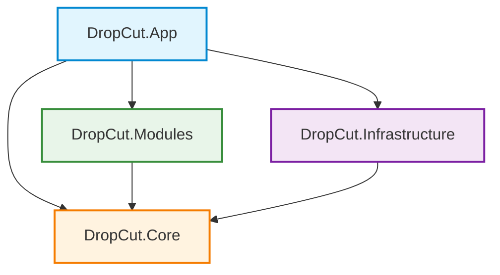

# DropCut — System Architecture & Blueprint

> **Phase 0 — Baseline Architecture Specification**  
> This document is the single authoritative source of truth for DropCut's technology choices, layer boundaries, dependency direction, and component design.

---

## 1. System Overview & Technology Stack

| Component | Technology Choice | Version / Standard | Rationale |
| :--- | :--- | :--- | :--- |
| **Runtime & SDK** | .NET LTS | 10.0 (10.0.401 pinned via `global.json`) | Modern high-performance C# runtime with NativeAOT readiness. |
| **UI Framework** | WinUI 3 / Windows App SDK | 1.6+ (Microsoft.WindowsAppSDK) | Windows 10/11 native UI matching Fluent Design, Mica Alt, and high-DPI rendering. |
| **Architecture Pattern** | Modular Vertical-Slice | Django-Apps / ERP Pattern | Self-contained feature slices; zero cross-module coupling; compile-time contract enforcement. |
| **Database Engine** | SQLite via EF Core | Microsoft.EntityFrameworkCore.Sqlite | High-performance, zero-configuration local persistence with ACID guarantees. |
| **Graphics & Ink** | WinUI 3 Canvas & Win2D | Microsoft.Graphics.Win2D | Hardware-accelerated 60fps ink rendering, shape drawing, and image manipulation. |
| **Drag & Drop** | Windows OLE DataPackage | WinUI 3 / `Windows.ApplicationModel.DataTransfer` | Native outward image and file dragging to external browsers and applications. |
| **Localization** | Custom Pure i18n Engine | JSON-based dictionary with RTL support | 10 global languages, Arabic RTL default, instantaneous switching without restart. |

---

## 2. Global Solution Structure & Layer Boundaries

```text
DropCut/
├── src/
│   ├── DropCut.App/                    # WinUI 3 Application Shell & Composition Root
│   │   ├── App.xaml / App.xaml.cs      # Host entry point & DI container bootstrapping
│   │   ├── MainWindow.xaml / .cs       # Multi-tab window shell
│   │   ├── Shared/                     # Reusable UI controls, styles, and converters
│   │   ├── Package.appxmanifest        # MSIX identity and capabilities
│   │   ├── app.manifest                # Windows OS compatibility manifest
│   │   └── DropCut.App.csproj
│   │
│   ├── DropCut.Modules/                # Self-Contained Feature Slices (Django-Style)
│   │   ├── Workspace/                  # Snapping engine, canvas annotations, outward drag-drop
│   │   ├── FileVault/                  # Continuous auto-save, recent captures, file export
│   │   ├── Permissions/                # Role-based feature policies and locks
│   │   ├── AuditLog/                   # Action history, undo/redo states, database logging
│   │   └── Settings/                   # Pure i18n localization, themes, hotkeys
│   │
│   ├── DropCut.Core/                   # Cross-Module Kernel & Contracts
│   │   ├── Contracts/                  # Shared interfaces (IEventBus, ICommandGateway)
│   │   ├── Domain/                     # Base entities, Result<T>, Guard clauses
│   │   ├── Events/                     # Strongly-typed domain events
│   │   ├── Security/                   # Security contracts & permission tokens
│   │   └── AI/                         # Provider-agnostic machine command interfaces
│   │
│   └── DropCut.Infrastructure/         # Persistence & Windows OS Adapters
│       ├── Persistence/                # DropCutDbContext, EF Core repositories
│       ├── FileSystem/                 # Atomic file storage with .tmp staging
│       └── Capture/                    # Windows Graphics Capture & Win32 screen APIs
│
├── tests/
│   ├── DropCut.Core.Tests/             # Unit tests for domain models and event bus
│   ├── DropCut.Modules.Tests/          # Isolated tests for module services and viewmodels
│   └── DropCut.App.Tests/              # UI tests and end-to-end integration tests
│
├── docs/                               # Governance and architecture documentation
│   ├── ARCHITECTURE.md                 # System blueprint (this file)
│   ├── PROJECT_RULES.md                # Development Constitution
│   ├── MODULE_CATALOG.md               # Registry of all modules and responsibilities
│   ├── DATABASE_SCHEMA.md              # SQLite schema, tables, and relationships
│   └── TASKS.md                        # Phased task execution roadmap
│
├── AGENTS.md                           # AI agent operational mandates
├── README.md                           # Project introduction and build instructions
├── global.json                         # .NET SDK pinning
├── .gitignore                          # Git exclusions
└── DropCut.sln                         # Master Visual Studio / .NET Solution
```

---

## 3. Dependency Direction & Compile-Time Propagation



### Laws of Dependency Direction:
1. **`DropCut.Core` is the Central Kernel**:
   - Contains NO references to WinUI, Windows App SDK, or EF Core.
   - 100% pure C# standard logic, contracts, domain events, and value objects.
2. **Modules Depend ONLY on `DropCut.Core`**:
   - `DropCut.Modules` never directly references `DropCut.Infrastructure` or sibling modules.
   - Any service required across modules is registered via `DropCut.Core/Contracts/`.
3. **Compile-Time Propagation**:
   - If a core contract or domain event changes, all consuming modules and infrastructure implementations are validated at compile-time by the compiler.
4. **Composition Root in `DropCut.App`**:
   - `DropCut.App` wires concrete infrastructure implementations to core contracts via Microsoft Dependency Injection (`IServiceCollection`).

---

## 4. Internal Anatomy of a Module (Django / ERP Style)

Every module under `src/DropCut.Modules/[ModuleName]/` is fully autonomous and must contain:

```text
DropCut.Modules/[ModuleName]/
├── Views/                  # XAML Views & UserControls (*Page.xaml, *View.xaml)
├── ViewModels/             # Presentation Logic (*ViewModel.cs)
├── Models/                 # Internal Domain Entities & DTOs (*Model.cs, *Dto.cs)
├── Contracts/              # Module-Specific Interfaces (I*Service.cs)
├── Services/               # Business Logic Implementations (*Service.cs)
├── Data/                   # Persistence Queries & Mappings (*Repository.cs)
├── Helpers/                # Utilities, Formatters & Validators (*Helper.cs)
└── [ModuleName]Module.cs   # DI Registration Entry Point (ServiceRegistration)
```

Each module exposes an extension method on `IServiceCollection`:
```csharp
public static class WorkspaceModule
{
    public static IServiceCollection AddWorkspaceModule(this IServiceCollection services)
    {
        services.AddTransient<ISnappingService, SnappingService>();
        services.AddTransient<IAnnotationCanvasService, AnnotationCanvasService>();
        services.AddTransient<WorkspaceViewModel>();
        return services;
    }
}
```

---

## 5. Reverse-Engineered Snipping Tool & Drag-Drop Architecture

### 5.1 Snapping Subsystem:
- High-DPI transparent window overlay covering all active monitors.
- Selection box rendered via hardware-accelerated Win2D canvas.
- 4 capture modes:
  1. **Rectangular**: Drag rectangle selection.
  2. **Window**: Hover detection of top-level Win32 window handles via `EnumWindows` and `GetWindowRect`.
  3. **Full-screen**: Instant capture across all monitors.
  4. **Freeform**: Freehand path polygon clipping.

### 5.2 Continuous Auto-Save Engine:
- On capture: initial snippet is persisted immediately to `%LocalAppData%\DropCut\Drafts\[Guid].png`.
- On edit (drawing stroke, text edit, crop):
  - Canvas publishes `ImageAnnotatedEvent`.
  - `AutoSaveService` debounces commit for 300ms.
  - Snapshot is saved atomically to disk using a temporary `.tmp` file and atomic replacement.
  - `AuditLog` captures state for instant Undo/Redo.

### 5.3 Interactive Outward Drag-and-Drop Sharing:
- When hovering over the rendered snippet canvas, the pointer changes to `CoreCursorType.Hand`.
- Pointer drag initiates `UIElement.StartDragAsync`:
  - Fills `DataPackage` with `StandardDataFormats.Bitmap` from memory stream.
  - Sets `StorageItems` with the absolute path of the auto-saved image file.
  - Allows seamless drop into Chromium/Edge browsers, WhatsApp Web, Discord, GitHub, Linear, Outlook, Slack, and Windows Explorer.

---

## 6. AI Abstraction Surface (`DropCut.Core/AI`)

- Core business logic remains 100% vendor-neutral.
- No direct coupling to OpenAI, Anthropic, Gemini, or local ONNX runtimes in Core.
- Machine-controllable command surface:
  - `IAICommandHandler`: Executes validated commands.
  - `IAIProvider`: Interface implemented by infrastructure adapters.
  - `AISecurityPolicy`: Validates every AI action against strict security bounds before execution.
